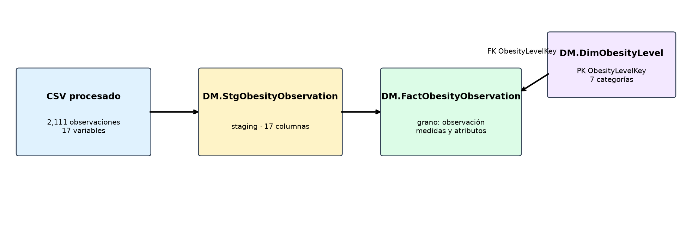
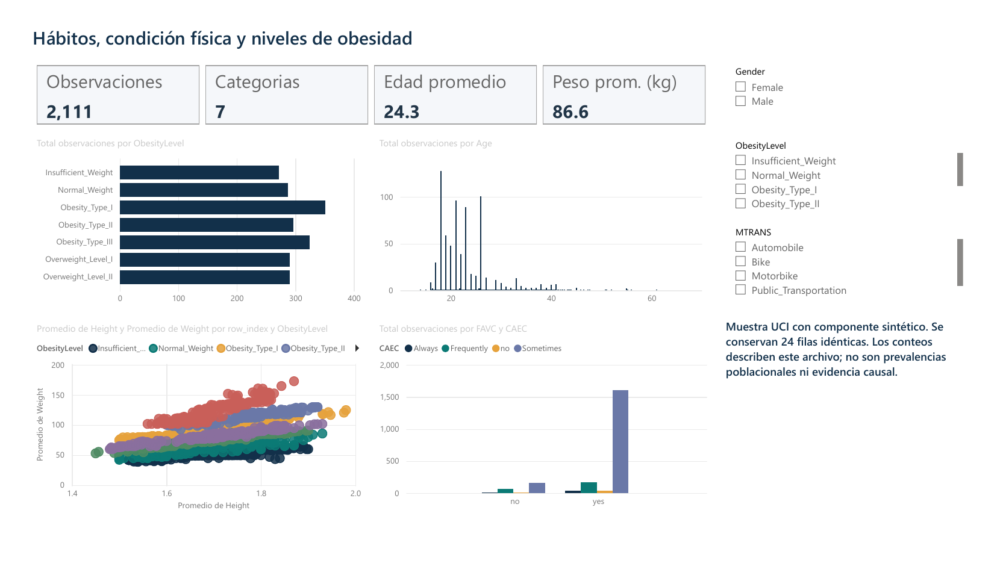
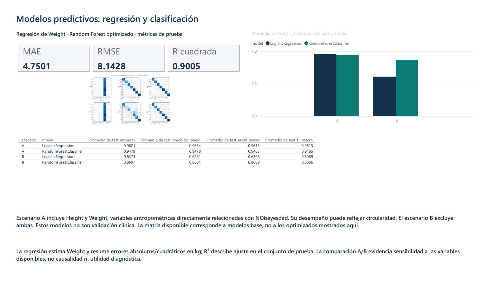
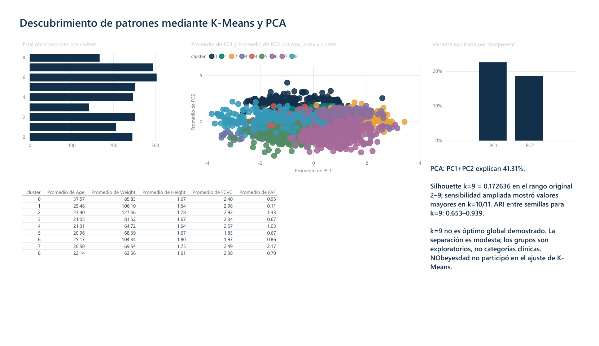
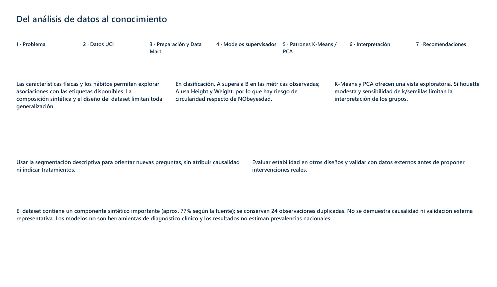

# Informe final integrador — ECBD 2026

## Portada

**Universidad Tecnológica de Tula-Tepeji** 
**Tecnologías de la Información** 
**Asignatura:** Extracción de Conocimiento en Bases de Datos 
**Estudiante:** David Rafael Aguilar Solis 
**Matrícula:** 22300607 · **Grupo:** 10IDGS-G1 
**Proyecto:** Análisis de hábitos y condición física asociados con niveles de obesidad 
**Entrega:** Proyecto Integrador — 20 de noviembre de 2026 
**Docente:** pendiente de confirmación documental

---

## Resumen

Este informe integra la preparación y exploración del conjunto UCI de obesidad, el diseño de un Data Mart en SQL Server, los experimentos supervisados para estimar `Weight` y clasificar `NObeyesdad`, el análisis exploratorio con K-Means y PCA, y un dashboard de cuatro páginas desarrollado en el proyecto Power BI PBIP. El CSV contiene 2,111 observaciones y 17 variables; se conservaron sus 24 filas exactamente duplicadas. Los resultados describen únicamente los artefactos y el conjunto analizados: no establecen relaciones causales, diagnóstico clínico ni representatividad poblacional.

## 1. Introducción y problema

Los hábitos alimentarios, la actividad física y las características antropométricas aparecen juntos en el conjunto UCI que motiva este proyecto. El reto de análisis consiste en describir sus patrones, preparar datos reproducibles y comparar modelos sin confundir asociación con causalidad. La etiqueta `NObeyesdad` es una categoría incluida en el dataset y se relaciona con medidas antropométricas; por ello, una clasificación con `Height` y `Weight` puede reproducir parte de la construcción de la propia etiqueta.

**Pregunta de trabajo:** ¿qué patrones descriptivos y de desempeño predictivo se observan entre hábitos, condición física y las categorías registradas de obesidad, y cuáles son los límites metodológicos de interpretarlos?

### Objetivo general

Integrar un proceso de extracción de conocimiento que prepare y explore el dataset UCI, estructure un Data Mart, evalúe modelos de regresión y clasificación, explore agrupamientos y reducción de dimensionalidad, y comunique los resultados y sus limitaciones mediante un dashboard Power BI y un informe reproducible.

### Objetivos específicos

1. Verificar procedencia, estructura, calidad y distribución de las 2,111 observaciones y 17 variables sin alterar el archivo original.
2. Preparar un derivado reproducible y estructurar observaciones y niveles de obesidad en un Data Mart de SQL Server.
3. Comparar modelos para `Weight` y `NObeyesdad` con particiones agrupadas por duplicados, pipelines y métricas calculadas en datos reservados.
4. Describir agrupamientos K-Means y la varianza representada por PC1 y PC2, sin usar la etiqueta para ajustar las transformaciones.
5. Integrar resultados verificados en cuatro páginas de Power BI y documentar las limitaciones para su lectura académica.

## 2. Alcance y metodología

El trabajo comprende cinco unidades académicas: planeación, análisis exploratorio/ETL/Data Mart, modelado supervisado, clustering/PCA y comunicación con dashboard. CRISP-DM organiza comprensión del problema y datos, preparación, modelado, evaluación y comunicación. Su aplicación es iterativa: los hallazgos de exploración informan la preparación; los resultados de modelos se evalúan por separado; el dashboard presenta resultados ya calculados. No se infieren entregas, defensa o aceptación docente a partir de artefactos técnicos.

## 3. Dataset y procedencia

La fuente es el dataset 544 del UCI Machine Learning Repository, *Estimation of Obesity Levels Based On Eating Habits and Physical Condition*. La publicación describe observaciones de individuos de México, Perú y Colombia, con una parte recolectada en una plataforma web y otra generada sintéticamente con Weka/SMOTE. La mezcla limita cualquier interpretación poblacional.

| Propiedad observada | Resultado |
|---|---:|
| Registros | 2,111 |
| Variables | 17 (16 entradas y `NObeyesdad`) |
| Valores faltantes | 0 |
| Filas idénticas | 24 |
| Categorías `NObeyesdad` | 7 |
| SHA-256 CSV original | `28b6991062855d3d15642e38b1aa9d1b32fb7abbb5abf5b096f1868cd706154b` |

Las variables incluyen género y antecedentes, hábitos de alimentación e hidratación, consumo de tabaco/alcohol, actividad física, uso de dispositivos, edad, estatura, peso, transporte y la etiqueta de nivel de obesidad. El diccionario completo, con tipos inferidos y dominios observados, está en [`unidad_ii/diccionario_datos.md`](unidad_ii/diccionario_datos.md). El CSV original permanece en `data/raw/`; el derivado U2 es `data/processed/obesity_unit_ii.csv`, UTF-8/LF y con las mismas filas y valores.

## 4. Exploración y preparación

La edad observada varía entre 14 y 61 años (media 24.31), la estatura entre 1.45 y 1.98 m (media 1.70) y el peso entre 39 y 173 kg (media 86.59). Los conteos de las siete clases oscilan entre 272 y 351 observaciones. Son distribuciones del archivo, no prevalencias externas.

El análisis documentado encontró 24 duplicados exactos y ningún faltante. Se conservaron los duplicados por trazabilidad y porque no hay una llave que permita decidir cuáles representan individuos distintos; en la evaluación supervisada se mantuvieron juntos en una partición. Algunos campos de escala presentan decimales en registros sintéticos. No se redondearon ni recortaron valores. La regla exploratoria 1.5×IQR marcó candidatos, especialmente en `NCP`; no se trataron como errores sin evidencia.

El ETL valida encabezados, tipos, valores finitos, dominios y conteos. Escribe exclusivamente en `data/processed/` y no altera la serialización del CSV raw. La comparación de origen y derivado quedó registrada por valores y hashes.

## 5. Data Mart y consultas analíticas

SQL Server contiene la base `REC_ECBD_Obesidad_2026`. El Data Mart separa niveles de obesidad en `DM.DimObesityLevel` y observaciones en `DM.FactObesityObservation`; el proceso usa staging para validar y cargar la fuente. Las claves y restricciones mantienen la relación de cada hecho con su categoría. El esquema y los scripts reproducibles están en `sql/` y el diagrama está en la figura siguiente.

La conexión del dashboard sólo consulta la dimensión `DM.DimObesityLevel`; los hechos del dashboard provienen del CSV U2 enriquecido con las asignaciones U4 por `row_index`. Esta separación evita cargar simultáneamente dos copias de hechos.

## 6. Regresión: predicción de `Weight`

Se compararon `DummyRegressor`, regresión lineal y Random Forest. El objetivo y la etiqueta `NObeyesdad` se excluyeron de los predictores. La partición reservada contiene 422 filas; las 1,689 filas de entrenamiento contienen los grupos restantes. Las filas idénticas se agruparon para no cruzar entrenamiento y prueba. La imputación, codificación y escalado forman parte de pipelines entrenados dentro de cada pliegue. La búsqueda de hiperparámetros usó validación cruzada de entrenamiento; el test se evaluó después de fijar la configuración.

| Modelo | MAE test | RMSE test | R² test | RMSE CV agrupada |
|---|---:|---:|---:|---:|
| DummyRegressor (media) | 21.9245 | 25.8146 | -0.0001 | 26.2825 |
| Regresión lineal | 13.4350 | 16.6931 | 0.5818 | 17.2341 |
| Random Forest optimizado | 4.7501 | 8.1428 | 0.9005 | 8.9627 |

El Random Forest seleccionado usó 150 árboles, profundidad ilimitada y hoja mínima 1. Su brecha entre RMSE de entrenamiento (3.1548) y de prueba (8.1428) indica ajuste más favorable al entrenamiento; la métrica de prueba no demuestra generalización fuera de la muestra.

## 7. Clasificación: `NObeyesdad`

Se evaluaron siete categorías. El **escenario A** incluye `Height` y `Weight` y puede ser circular porque ambas medidas participan en la definición antropométrica de la etiqueta. El **escenario B** excluye esas dos medidas y usa hábitos y otras variables disponibles. Los siguientes resultados pertenecen a modelos optimizados; la figura de matrices incluida en el dashboard corresponde exclusivamente a clasificadores base.

| Escenario | Modelo optimizado | Accuracy | Precision macro | Recall macro | F1 macro | F1 macro CV |
|---|---|---:|---:|---:|---:|---:|
| A | Regresión logística (`C=10`) | 0.9621 | 0.9634 | 0.9613 | 0.9615 | 0.9310 |
| A | Random Forest (100 árboles) | 0.9479 | 0.9478 | 0.9463 | 0.9465 | 0.9326 |
| B | Regresión logística (`C=10`) | 0.6374 | 0.6261 | 0.6308 | 0.6089 | 0.5791 |
| B | Random Forest (150 árboles) | 0.8697 | 0.8664 | 0.8669 | 0.8666 | 0.8287 |

La optimización maximizó F1 macro mediante validación cruzada estratificada y agrupada, usando sólo entrenamiento. Las cifras describen diferencias predictivas observadas en este dataset; no atribuyen efectos a hábitos particulares ni tienen utilidad diagnóstica.

## 8. Clustering y PCA

K-Means usó `Age`, `Height`, `Weight`, `FCVC`, `NCP`, `CH2O`, `FAF` y `TUE`, escaladas con `StandardScaler`, semilla 42 y `n_init=20`. La etiqueta no participó en el ajuste. En el rango inicial k=2–9, Silhouette alcanzó 0.172636 en k=9, el límite del rango; el análisis de sensibilidad extendido encontró valores mayores en k=10 y k=11. Por tanto, k=9 es una solución exploratoria documentada, no un óptimo global.

| Componente | Varianza explicada | Acumulada |
|---|---:|---:|
| PC1 | 22.65% | 22.65% |
| PC2 | 18.66% | 41.31% |

La proyección bidimensional omite la mayoría de la variación. Las distancias también pueden estar dominadas por las medidas antropométricas, aun después de estandarizar; los grupos no deben interpretarse como subtipos clínicos.

## 9. Dashboard e integración

El PBIP existente organiza cuatro páginas: (1) panorama y distribuciones, (2) métricas supervisadas A/B y matrices etiquetadas como base, (3) tamaños/perfiles de clusters y PCA, y (4) hallazgos, recomendaciones y limitaciones. La tabla `FactDashboard` contiene 2,111 observaciones y se enriquece con 2,111 asignaciones U4 completas mediante índice único `row_index`; se conservaron duplicados.

La dimensión de obesidad filtra los hechos: el filtro `Normal_Weight` mostró 287 observaciones y, al limpiarlo, el total volvió a 2,111. En Power BI Desktop se verificó interactivamente la propagación `ClusterProfile` → `FactDashboard`: al seleccionar cluster 0, el gráfico de hechos mostró sólo ese grupo y la tabla de perfiles quedó en cluster 0; las asignaciones fuente contienen 246 observaciones en ese grupo. Al restaurar el rango completo reaparecieron los nueve clusters. La evidencia visual separada está en `dashboard/evidencias/cluster_interaction_2026-11-18.png`. En una prueba independiente, `Normal_Weight` redujo el KPI a 287 observaciones; al quitar la selección regresó a 2,111.

Las métricas del dashboard proceden del CSV U3; perfiles y varianza proceden de resultados U4. Los resultados supervisados no se recalcularon para crear el dashboard. Los archivos de origen, la matriz de relaciones y los parámetros configurables de ruta e instancia se describen en `dashboard/powerbi/`.

## 10. Conclusiones sustentadas

1. El Random Forest de regresión redujo el MAE de 21.9245 del baseline constante a 4.7501 en el test reservado; el R² de 0.9005 describe ajuste en esta muestra y debe leerse junto con la brecha entrenamiento/prueba.
2. La regresión logística optimizada del escenario A obtuvo F1 macro 0.9615; el Random Forest optimizado del escenario B obtuvo 0.8666. Estos valores corresponden a algoritmos distintos. Para comparar Random Forest entre escenarios, A obtuvo 0.9465 y B 0.8666. El escenario A usa `Height` y `Weight`, variables relacionadas con la etiqueta; las diferencias no prueban que los hábitos causen o expliquen el nivel de obesidad.
3. PC1 y PC2 explican en conjunto 41.31%; la visualización bidimensional deja fuera 58.69% de la varianza.
4. La Silhouette modesta y el aumento del valor observado al probar k=10/11 impiden sostener que k=9 sea una partición óptima global.

## 11. Recomendaciones prudentes

1. Usar el dashboard para describir el conjunto y explorar filtros; evitar convertir asociaciones o predicciones internas en diagnóstico, prevalencia o recomendación clínica.
2. Antes de generalizar los modelos o segmentos, validar con datos externos representativos y revisar sensibilidad a variables, duplicados y configuración de clusters con supervisión académica.

## 12. Limitaciones y reproducibilidad

La fuente combina registros recolectados y sintéticos, conserva duplicados exactos y no identifica individuos. El alcance geográfico y el proceso de generación limitan representatividad. Los modelos miden predicción en particiones del mismo dataset; clustering es exploratorio; no hay inferencia causal ni validación poblacional. `data/raw/ObesityDataSet_raw_and_data_sinthetic.csv` debe mantenerse intacto. Para reproducir el dashboard se requiere Power BI Desktop, los CSV procesados/resultados incluidos en el proyecto, SQL Server con el Data Mart y configurar los parámetros `ProjectRoot`, `SqlInstance` y `SqlDatabase` para cada equipo.

La evidencia de ejecución técnica se conserva en los manifiestos y verificaciones de U2–U4 y dashboard. La ejecución automatizada no sustituye la revisión académica. No hay evidencia en este repositorio que acredite entrega en Classroom, defensa ni aceptación docente.

## Referencias

- UCI Machine Learning Repository. (2019). *Estimation of Obesity Levels Based On Eating Habits and Physical Condition* (Dataset 544). https://doi.org/10.24432/C5H31Z
- Mendoza Palechor, F., & de la Hoz Manotas, A. (2019). Dataset for estimation of obesity levels based on eating habits and physical condition in individuals from Colombia, Peru and Mexico. *Data in Brief, 25*, 104344. https://doi.org/10.1016/j.dib.2019.104344
- Microsoft. (s. f.). *Power Query SQL Server connector*. https://learn.microsoft.com/en-us/power-query/connectors/sqlserver
- Microsoft. (s. f.). *Tabular Model Definition Language (TMDL)*. https://learn.microsoft.com/en-us/analysis-services/tmdl/tmdl-overview?view=sql-analysis-services-2025

## Apéndice — Capturas del dashboard revisado

Las cuatro páginas se exportaron desde el PBIP reabierto y actualizado en Power BI Desktop el 18 de noviembre de 2026. Son capturas nuevas de esa sesión; la selección temporal del filtro de cluster se conserva por separado.

### Página 1 — Panorama general

### Página 2 — Modelos supervisados

La matriz mostrada corresponde a clasificadores base. Las métricas comparativas son de modelos optimizados y se presentan por separado.

### Página 3 — Clustering y PCA

### Página 4 — Hallazgos y conclusiones

